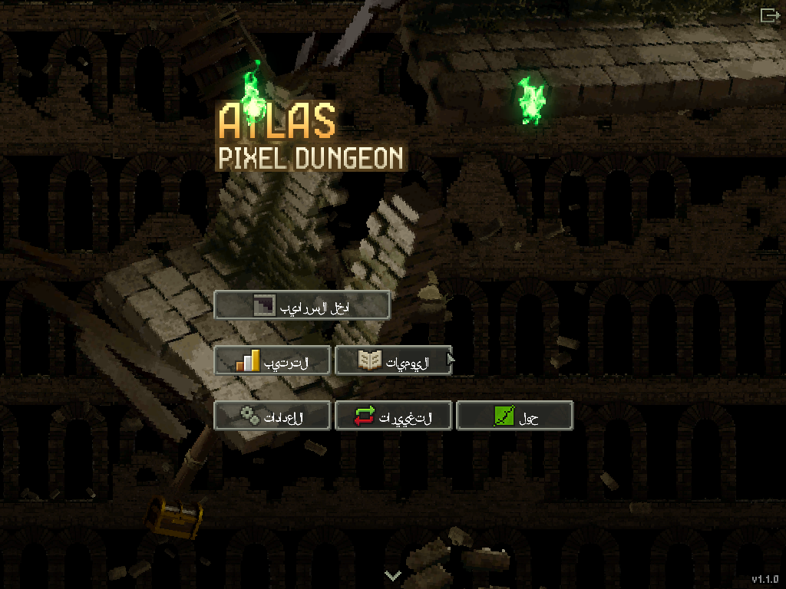
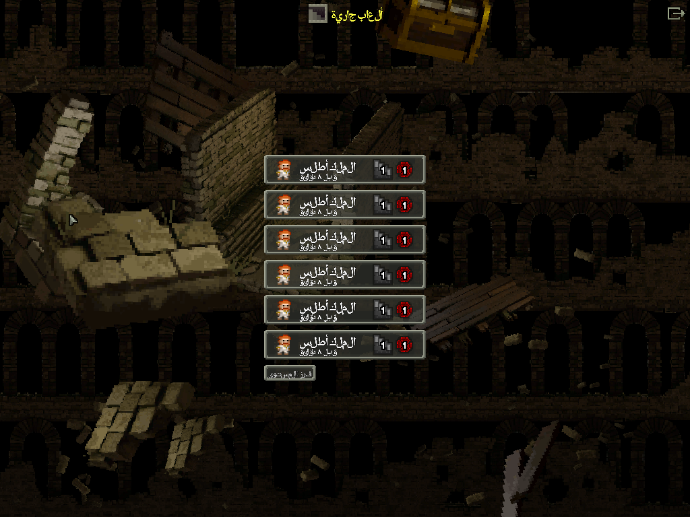
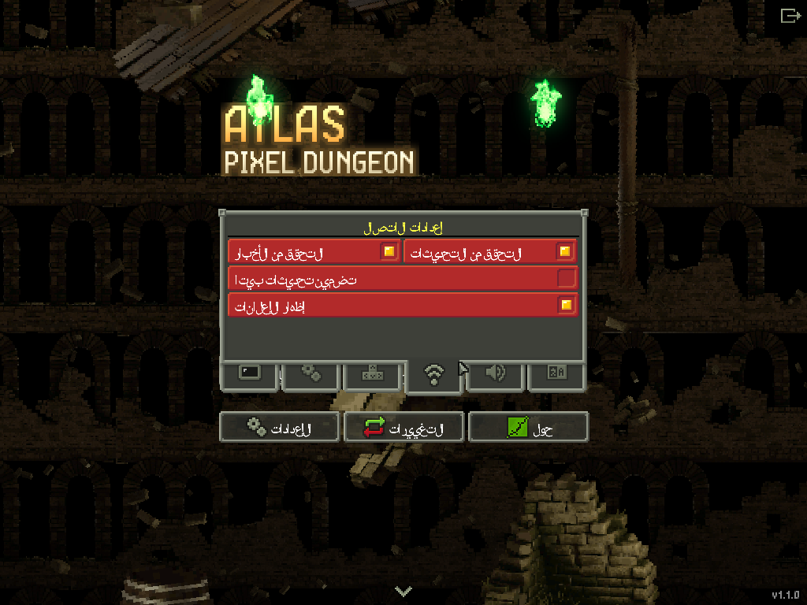

# Atlas Pixel Dungeon | سراديب أطلس

**لعبة تقمّص أدوار (Roguelike) داخل سراديب خطيرة مولّدة عشوائيًا — بنسخة عربية كاملة.**

Atlas Pixel Dungeon هي طبعة جديدة من لعبة Shattered Pixel Dungeon مفتوحة المصدر، بهوية وقصة جديدتين مستوحاتين من أسطورة الملك أطلس، صانع الخرائط الأسطوري الذي وحّد مملكة ماوريطانيا القديمة وختم ظلامًا عتيقًا تحت قصره. انزل عبر خمس طبقات من مملكته المدفونة، اهزم حرّاسها، وانتزع **تاج أطلس** من الظلام المختوم.

**Atlas Pixel Dungeon is a reimagined edition of the open-source roguelike Shattered Pixel Dungeon** — a new world, new heroes, and a complete hand-made Arabic translation. Descend through the buried kingdom of the legendary King Atlas, defeat its five guardians, and claim the **Crown of Atlas**.

---

## لقطات | Screenshots






---

## الأبطال الستة | The Six Heroes

| البطل | Hero | الوصف |
|---|---|---|
| الملك أطلس | **Atlas King** | محارب صلب؛ يتحمل ضررًا أقل كلما تضرّر درعه |
| حكيم النجوم | **Star Sage** | ساحر يوجّه قوة عصاه السحرية |
| ظل الكثبان | **Dune Shadow** | مخادع سريع يضرب من الظل |
| صيّادة الأرز | **Cedar Huntress** | صيّادة بروح رفيقة وقوس لا يخيب |
| نصل السيروكو | **Sirocco Blade** | مبارزة تزداد قوة مع كل ضربة متتالية |
| كاهن الفجر | **Dawn Priest** | رجل دين يحمل مخطوطة الفجر ويخدم الضعفاء |

## المناطق والزعماء | Regions & Bosses

الصهاريج الغارقة (The Sunken Cisterns) — **سيد الوحل The Mirelord**
سجن السلاسل (The Prison of Chains) — **حارس السلاسل The Chain Warden**
كهوف الجذور (The Root Caves) — **المحرّك المدفون The Buried Engine (AE-300)**
المدينة المدفونة (The Buried City) — **الملك المدفون The Buried King**
القاعات المختومة (The Sealed Halls) — **الظلام المختوم The Sealed Darkness**

---

## كيفية اللعب | How to Play

**الهدف:** انزل إلى أعمق طابق، اهزم الظلام المختوم، وخذ تاج أطلس ثم اصعد به إلى السطح. الموت دائم — إذا سقط بطلك تبدأ من جديد بسراديب مختلفة.

**The goal:** descend to the deepest floor, defeat the Sealed Darkness, take the Crown of Atlas, and escape back to the surface. Death is permanent — every run generates a brand-new dungeon.

**التحكم | Controls**
- **النقر / اللمس (Tap / Click):** التحرك، الهجوم، فتح الأبواب، التقاط الغنائم، استعمال السلالم
- **أزرار الواجهة:** الحقيبة (المخزون)، الانتظار، البحث عن الفخاخ والأبواب السرية، القائمة
- **على الحاسوب:** الأسهم أو WASD للتحرك، والماوس لكل شيء آخر

**نصائح للبقاء | Survival tips**
- كل طابق فيه لفافة تطوير واحدة على الأقل — طوّر سلاحك أو درعك الأفضل.
- الجرعات واللفافات مجهولة في البداية؛ جرّبها بعيدًا عن الخطر.
- ابحث في الجدران: الأبواب السرية تخفي كنوزًا وطوابق إضافية.
- كل 5 طوابق زعيم — جهّز جرعات الشفاء والتطوير قبل النزول.
- الطعام يقيك الجوع؛ لا تأكل حتى تشبع تمامًا إلا عند الحاجة.

---

## المزايا | Features

- **ترجمة عربية كاملة 100%** — كل نصوص اللعبة (نحو 5,000 نص) مترجمة يدويًا، بخط عربي واضح واتجاه صحيح من اليمين لليسار
- **22 لغة** مدعومة في الإعدادات
- **6 أبطال** بـ12 فئة فرعية ومواهب متعددة
- سراديب مولّدة عشوائيًا: لا جولتين متشابهتين أبدًا
- **إعلانات اختيارية**: إعلان واحد قصير عند نهاية الجولة فقط (بعد أول 3 جولات)، ويمكن إيقافها نهائيًا من الإعدادات ← الاتصال ← «إظهار الإعلانات»
- بدون تتبّع وبدون جمع بيانات

## البناء من المصدر | Building from Source

```
# Desktop (JDK 17+)
./gradlew desktop:run

# Android
./gradlew android:assembleRelease   # or open the project in Android Studio
```

## الاعتمادات والرخصة | Credits & License

- تطوير هذه الطبعة: **Mohammed Guejjim** (محمد قجيم)
- مبنية على **Shattered Pixel Dungeon** من تطوير **Evan Debenham (00-Evan)**: https://github.com/00-Evan/ShatteredPixelDungeon
- اللعبة الأصلية **Pixel Dungeon** من **Watabou**
- مرخّصة تحت **GNU GPL v3.0** — انظر ملف LICENSE. يمكنك نسخها وتعديلها وتوزيعها تحت نفس الرخصة، مع بقاء اعتمادات المطوّرين الأصليين.
