<p align="center">
  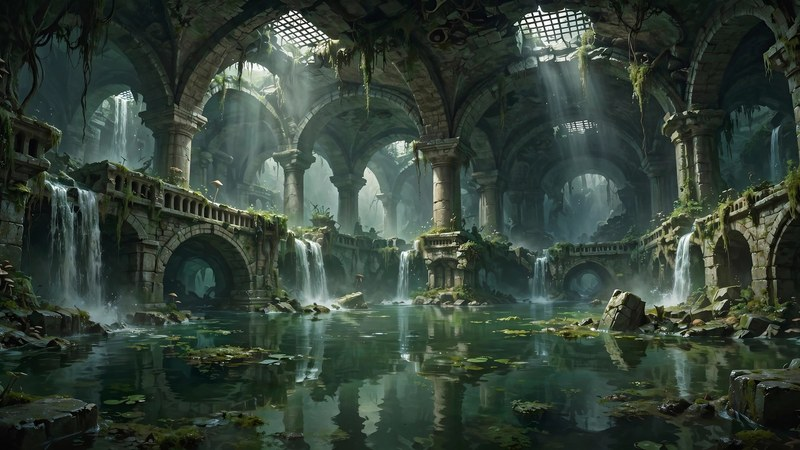
</p>

<h1 align="center">Atlas Pixel Dungeon</h1>

<p align="center">
  <em>Descend into the buried kingdom of King Atlas. Claim the Crown. Seal the darkness again — or be sealed with it.</em>
</p>

<p align="center">
  
  
  
  
</p>

<p align="center">
  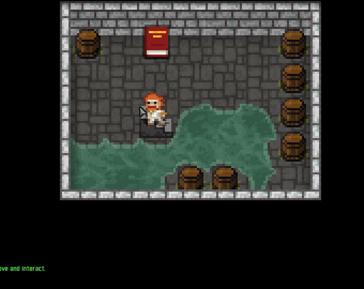
</p>

**Atlas Pixel Dungeon** is a traditional roguelike dungeon crawler with randomly generated levels, hundreds of items, and turn-based tactical combat. Every run is different: the floors, the loot, the enemies and the dangers are generated fresh each time you play — and death is permanent.

It is a full reimagining of the open-source classic *Shattered Pixel Dungeon*, rebuilt around a new legend: **Atlas**, the ancient king and cartographer who mapped the mountains, forged the **Crown of Atlas**, and sealed an ancient darkness beneath his kingdom. The city above still whispers that the Crown rests in the depths below. Many heroes have gone down to claim it. None have returned.

Will you conquer the dungeon and claim the Crown?

## ✨ Features

- **A complete new world and story** — a buried kingdom in five layers, with rewritten lore, characters, enemies and endings
- **6 heroes**, each with unique abilities, and **12 subclasses** to specialize into
- **25 floors** of procedurally generated dungeon, plus generated side-floors and quests
- **5 bosses**, each with its own arena and mechanics
- **Hundreds of items**: weapons, armor, wands, rings, artifacts, potions, scrolls, seeds and more
- **Pacts of Atlas** *(v1.2.0)* — swear up to 3 optional pacts before a run; each grants a boon and exacts a price, changing how the dungeon plays: reveal every floor's layout while enemies hit harder, swell gold piles while shop prices climb, double a chest's contents while mimics grow bolder, and five more
- **Full Arabic localization** with proper connected-script rendering — alongside 21 other languages
- **In-game news and updates served from this very repository** (see [`news.xml`](news.xml))
- **No account, no always-online requirement** — a classic single-player roguelike
- **Completely free and open source** under the GNU GPL-3.0

## 🗡️ The Heroes

<table>
  <tr>
    <td align="center" width="33%">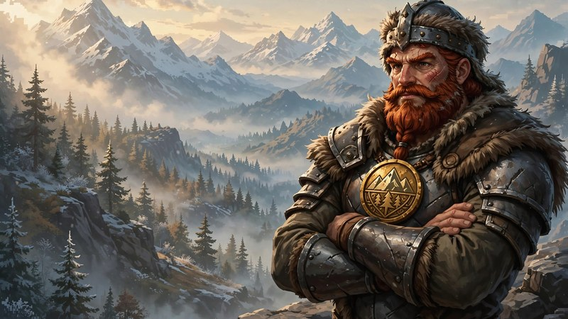<br><b>Atlas King</b><br>The heir of the mountain throne. His <b>mountain seal</b> turns part of the damage he takes into shielding, and the seal can carry a single upgrade between armors. A durable front-line fighter.</td>
    <td align="center" width="33%">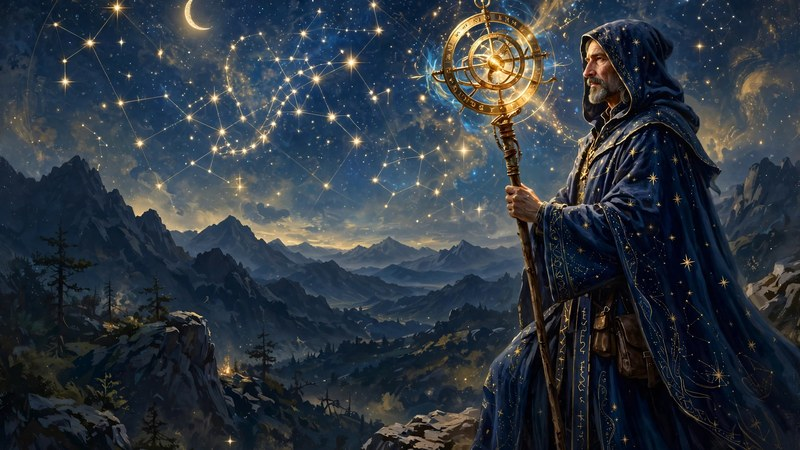<br><b>Star Sage</b><br>A scholar of the celestial charts. Begins with a <b>magic staff</b> that can be imbued with any wand he finds, growing stronger as he masters the arcane.</td>
    <td align="center" width="33%">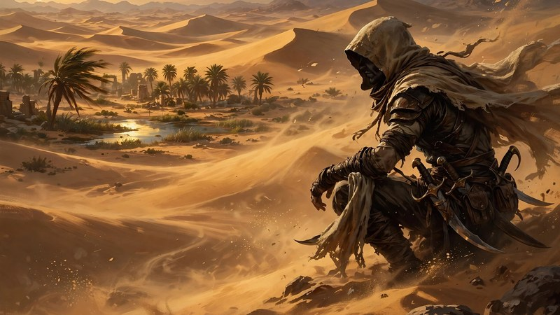<br><b>Dune Shadow</b><br>A silent walker of the sands. His <b>dune cloak</b> lets him vanish from sight and strike from the shadows for devastating surprise attacks.</td>
  </tr>
  <tr>
    <td align="center" width="33%">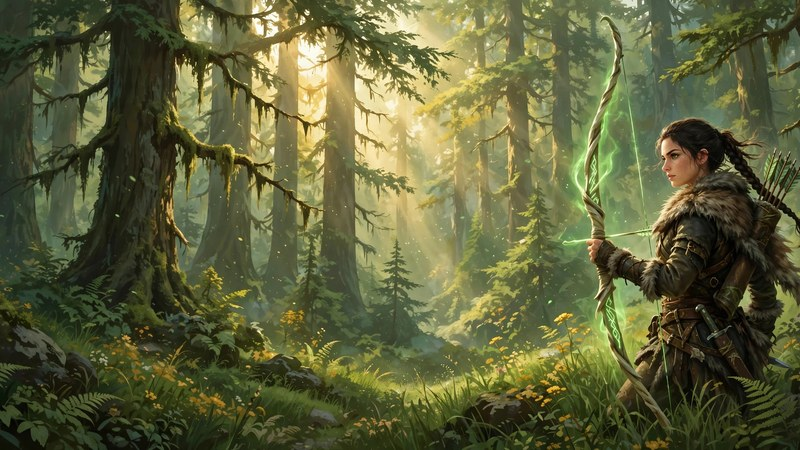<br><b>Cedar Huntress</b><br>Raised among the cedar forests. Her <b>spirit bow</b> never runs out of arrows, and her senses reach through grass and walls to track her prey.</td>
    <td align="center" width="33%">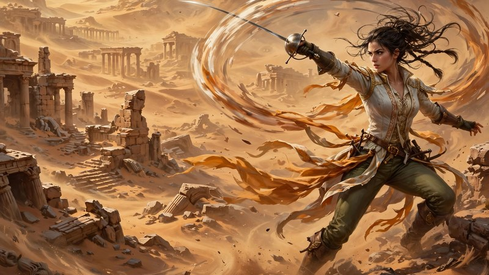<br><b>Sirocco Blade</b><br>Fast as the desert wind. A duelist who unlocks a special <b>weapon ability</b> from every weapon she wields, and chains them together in flowing combos.</td>
    <td align="center" width="33%">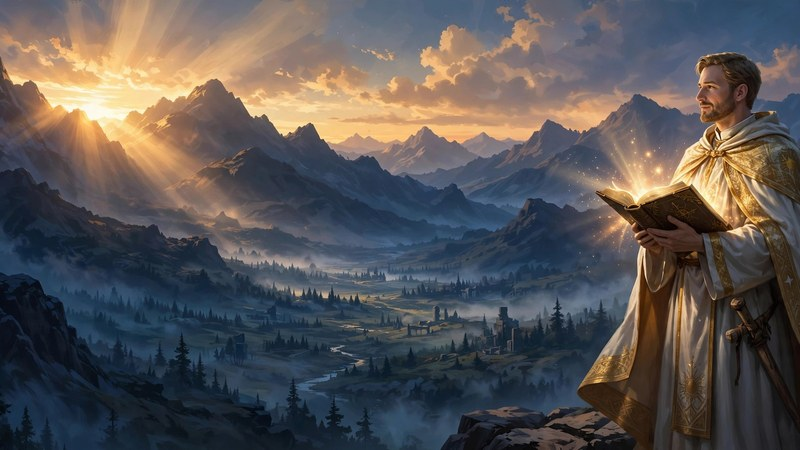<br><b>Dawn Priest</b><br>A servant of the first light. Carries the <b>Tome of Dawn</b>, whose divine spells grow in power as he gains experience and guides his flock of light through the dark.</td>
  </tr>
</table>

Every hero can choose between **two subclasses** at depth, spend **talent points** as they level up, and — after proving themselves — attempt **challenge runs** with special rules for veteran players.

## 🏰 The Buried Kingdom

The dungeon is the buried kingdom of Atlas itself, sunk layer by layer beneath the mountain:

<table>
  <tr>
    <td></td>
    <td><b>1 · The Sunken Cisterns</b> (floors 1–5)<br>The great vaults that once fed the city above with mountain water. The harmless creatures of the vaults have grown ferocious as dark energy crept up from below.<br>Boss: <b>The Mirelord</b></td>
  </tr>
  <tr>
    <td>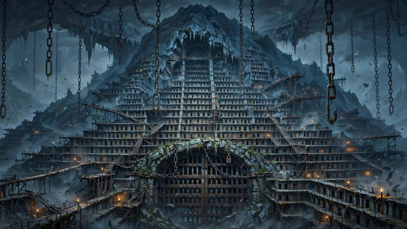</td>
    <td><b>2 · The Prison of Chains</b> (floors 6–10)<br>Where the king's prisoners — and later, his secrets — were kept under lock and ward. Something down here still rattles its chains.<br>Boss: <b>The Chain Warden</b></td>
  </tr>
  <tr>
    <td>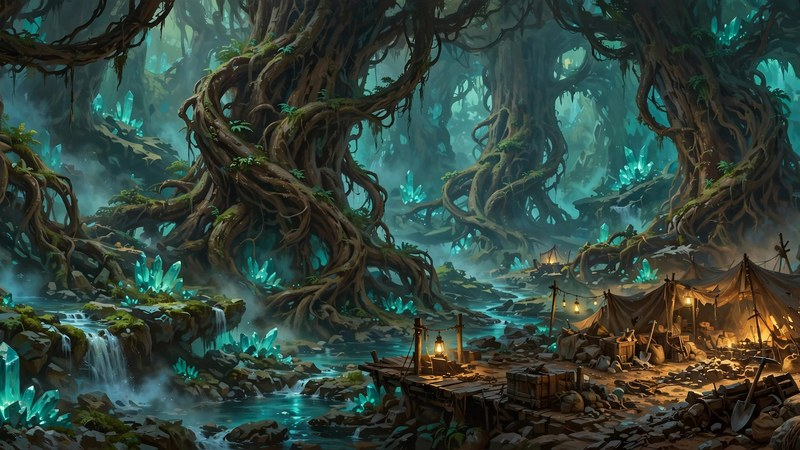</td>
    <td><b>3 · The Root Caves</b> (floors 11–15)<br>Natural caverns pierced by the roots of the great cedars above. The old mining engines were left running — and they do not like visitors.<br>Boss: <b>The Buried Engine (AE-300)</b></td>
  </tr>
  <tr>
    <td>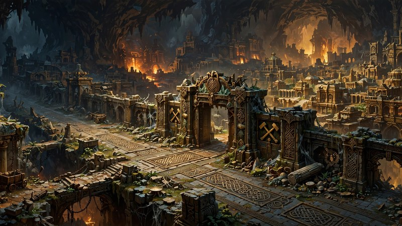</td>
    <td><b>4 · The Buried City</b> (floors 16–20)<br>The capital itself, entombed with its king. Its last monarch still sits the throne, and he does not receive guests kindly.<br>Boss: <b>The Buried King</b></td>
  </tr>
  <tr>
    <td>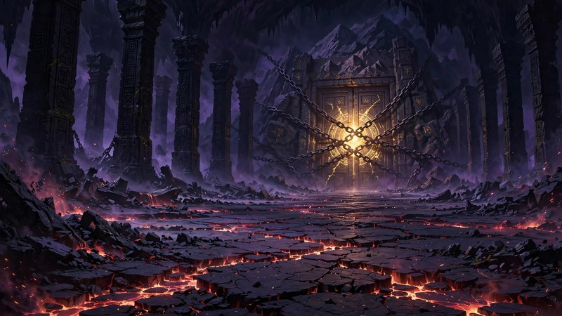</td>
    <td><b>5 · The Sealed Halls</b> (floors 21–25)<br>Below the city, behind doors that were never meant to open, waits what King Atlas sealed away at the cost of his kingdom.<br>Boss: <b>The Sealed Darkness</b></td>
  </tr>
</table>

## 👹 The Bosses

<p align="center">
  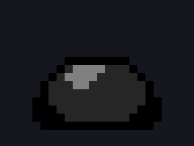
  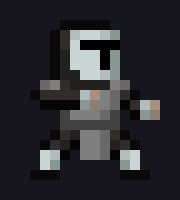
  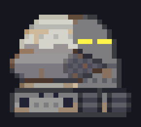
  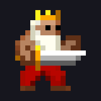
  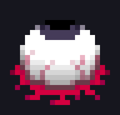
</p>

- **The Mirelord** — a living mass of cistern filth that splits, heals, and poisons the water you stand in
- **The Chain Warden** — the prison's masked keeper, who vanishes between the pillars and strikes without warning
- **The Buried Engine (AE-300)** — a colossal mining machine that floods its chamber and calls its lesser engines to war
- **The Buried King** — the last king of the buried city, raising his dead court to defend the throne
- **The Sealed Darkness** — the ancient evil Atlas could not destroy, only imprison. Break the seal at your peril

## 🎮 How to Play

**Goal.** Descend to floor 26, take the **Crown of Atlas**, and — if you dare — bring it back to the surface for the true ending. Death is permanent: when you fall, that hero's story ends, and a new hero descends.

**Controls**

- **Touch / mouse:** tap a tile to walk there, tap an enemy to attack, tap items to pick them up and use them
- **Desktop:** mouse, `WASD` or arrow keys to move, and full keyboard shortcuts for inventory and actions

**Survival basics**

1. **Everything is unidentified.** Potions and scrolls are random in every run — identify them by use, by scroll, or by careful experiment (preferably somewhere safe, standing in water)
2. **Eat.** Hunger is a slow enemy of its own. Rations drop from enemies and hide in the dungeon's storerooms
3. **Upgrade wisely.** Scrolls of upgrade are limited; a focused weapon or armor carries a run further than spreading upgrades thin
4. **Use the terrain.** Doors, grass, water and chasms are weapons: burn, hide, surprise, and knock enemies into the deep
5. **Know when to run.** A seeded garden, a locked door, a narrow bridge — position wins fights that stats cannot

**Progression.** Heroes gain experience and **talent points**, choose a **subclass** after the second boss, and can empower a chosen armor or weapon with powerful enchantments and glyphs. Optional **challenges** and daily **seeded runs** await veterans.

## 📸 Screenshots

<p align="center">
  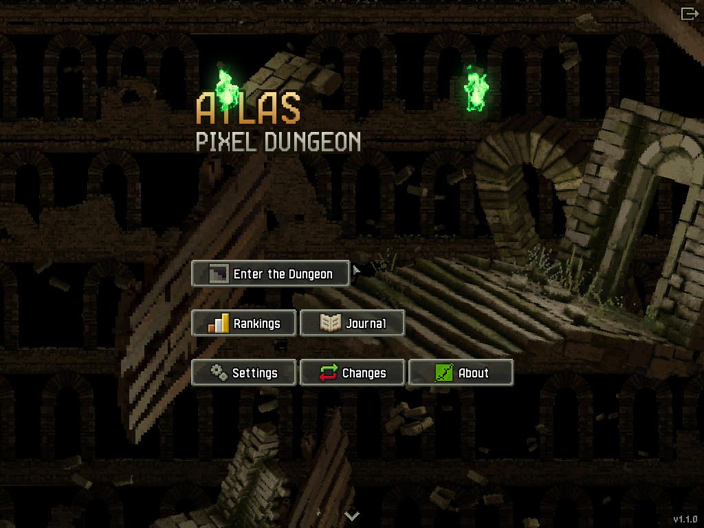
  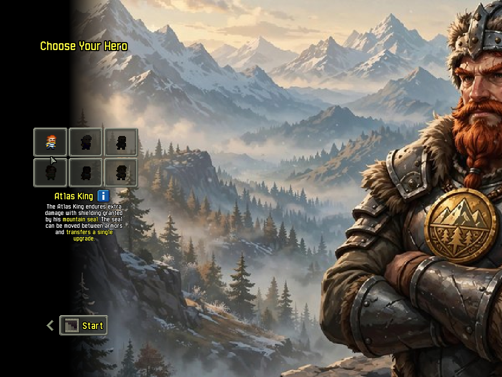
</p>
<p align="center">
  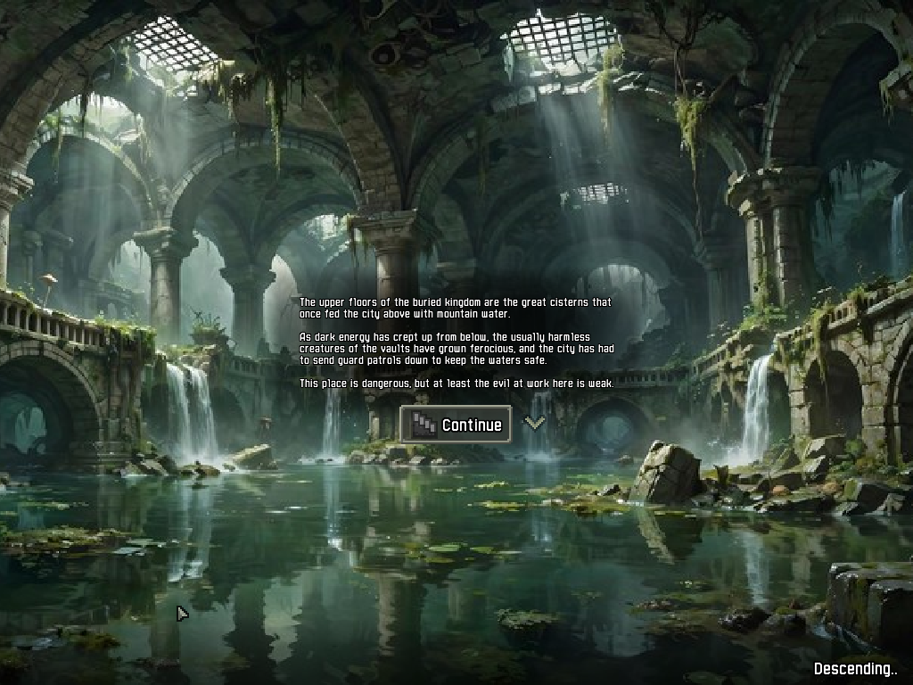
  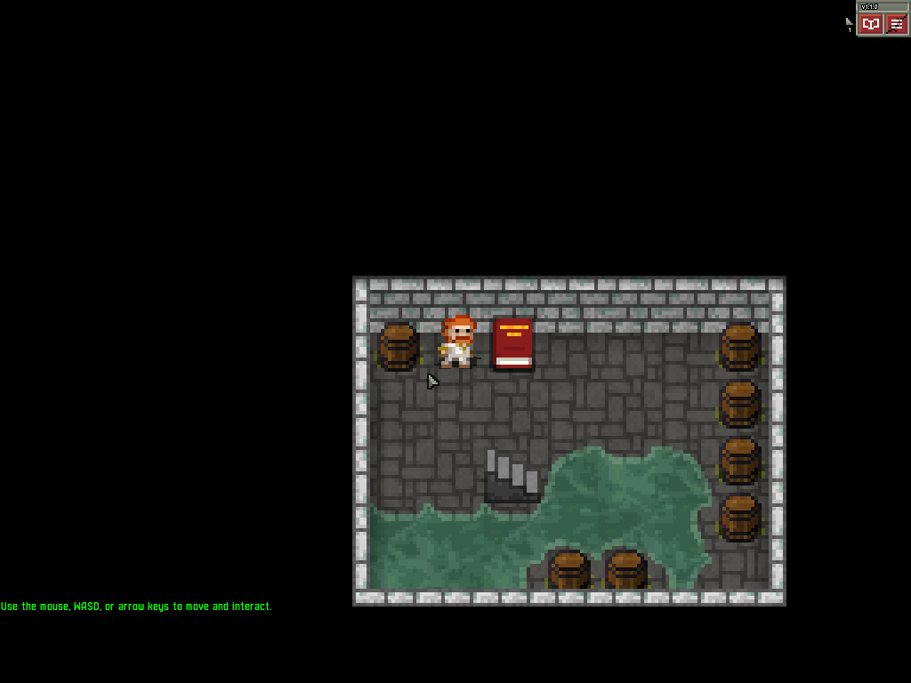
</p>

## 🌍 Languages

Atlas Pixel Dungeon ships with **22 languages**, including a complete, hand-reviewed **Arabic** translation with fully connected script rendering and right-to-left interface support. Switch language any time in **Settings**.

## 📰 News & Updates

The game's news window and update checker read directly from **this repository**:

- News articles come from [`news.xml`](news.xml) — edit it and push to publish an article to every player
- Update notices compare against the [releases](../../releases) of this repository

No third-party servers are contacted.

## 🛠️ Building

Atlas Pixel Dungeon is a Java / [libGDX](https://libgdx.com/) project (JDK 17, Gradle).

```bash
# Desktop
./gradlew desktop:run

# Android (open the project in Android Studio, or)
./gradlew android:assembleRelease
```

## 🙏 Credits & License

Atlas Pixel Dungeon is a derivative work of **Shattered Pixel Dungeon**, created by [Evan Debenham](https://shatteredpixel.com/), which is itself based on **Pixel Dungeon** by Watabou. All original credits are preserved in-game under **About**.

- **Atlas edition** (story, identity, translations, and this release): [Mohammed Guejjim](https://github.com/ellsimohammed8-prog)
- **License:** [GNU GPL-3.0](LICENSE.txt) — free to play, study, modify and redistribute under the same license
